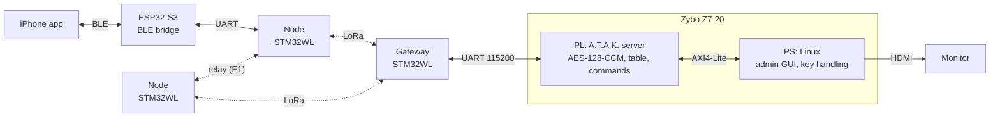

# A.T.A.K.

Team position tracking over LoRa without cellular coverage. Each team member carries an STM32WL node that reports
its GPS position; a gateway forwards the radio traffic to a Zynq server (Zybo Z7-20) whose programmable logic keeps
the team table, authenticates every frame and broadcasts the table back to all nodes. An admin station on the same
board shows the team on a map over HDMI and sends commands. Phones connect to a node through an ESP32 BLE bridge.

## Repository

| Path | Content | Owner |
|---|---|---|
| [`docs/`](docs/README.md) | System, protocol, security, testing and deployment documentation | shared |
| `firmware/stm32wl/` | Node and gateway firmware | Aykut |
| [`fpga/pl/`](fpga/pl/README.md) | PL server RTL, testbenches, Vivado build | Bartu |
| [`fpga/ps/`](fpga/ps/README.md) | PetaLinux configuration, station scripts, admin GUI | Bartu |
| `esp32-bridge/` | ESP32 BLE ↔ UART bridge (ESP-IDF) | Aykut |
| `mobile-app/` | Flutter phone app | Aykut |
| `tools/uart/` | PC tools to inject and decode gateway UART frames | Bartu |

## Versions

| Component | Version |
|---|---|
| PL server (`atk_axi`) | v12, ID `0x41544B0C` |
| Node / gateway firmware | V1.17.3 |

A PL version and a firmware version are compatible when they implement the same revision of
[`docs/protocol.md`](docs/protocol.md).

## Quick start

| Task | Where |
|---|---|
| Build the bitstream and XSA | [`fpga/pl/README.md`](fpga/pl/README.md#building) |
| Run the PL testbenches | [`fpga/pl/README.md`](fpga/pl/README.md#simulation) |
| Build the Zybo boot image and GUI | [`fpga/ps/README.md`](fpga/ps/README.md#building) |
| Load or change the network key | [`fpga/ps/README.md`](fpga/ps/README.md#security-operations-atk_secsh) |

## Secrets

The network key, SSH host keys and board passwords are never committed. The repository contains placeholders
only (`net_key.example.h`, `CHANGE_ME` in the PetaLinux `rootfs_config`); `.gitignore` excludes the real files.
Keys are exchanged over a private channel, not through this repository or the team chat.

Boot images and other build outputs are published as GitHub Releases, not committed.
