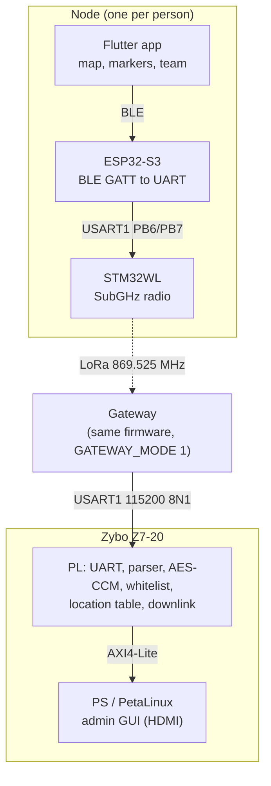
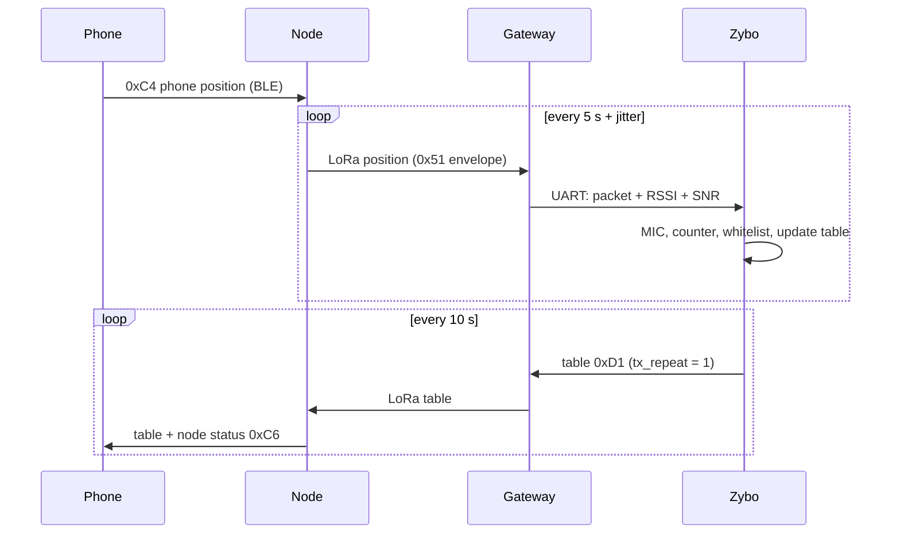
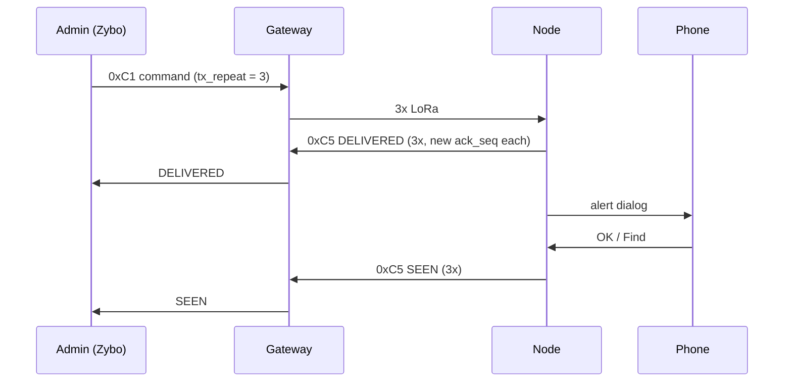
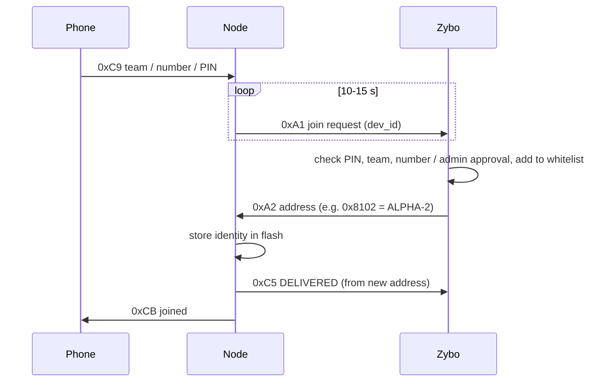
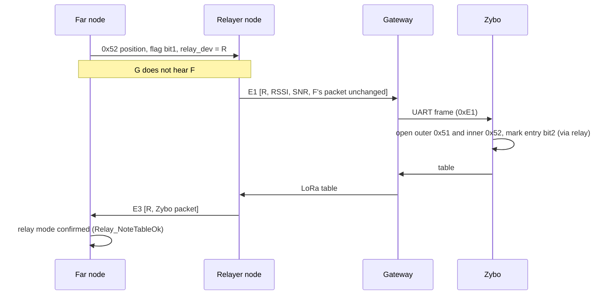

# Architecture

## Requirements

- Fully local: no internet, cloud or cellular network.
- Team size not fixed; target 16-30 nodes.
- The admin station rejects unknown devices in hardware (whitelist in the PL).
- Field user sees everyone on a map, can place markers and receives admin commands.
- Air traffic must not be readable, forgeable or replayable (Phase 1: shared key, see [`security.md`](security.md)).

## Components

| Component | Role | Documentation |
|---|---|---|
| Phone app | Map, markers, team JOIN; supplies its GPS position to the node (`0xC4`) | [`mobile-app/`](../mobile-app/README.md) |
| ESP32 bridge | The STM32WL has no BLE: UART frame to BLE notify and BLE write to UART frame | [`esp32-bridge/`](../esp32-bridge/README.md) |
| Node | Transmits position, forwards table and commands to the phone, sends ACKs, relays a neighbour when needed | [`firmware/stm32wl/`](../firmware/stm32wl/README.md) |
| Gateway | Pipe between radio and Zybo. Holds no key; forwards secure frames unopened | [`firmware/stm32wl/`](../firmware/stm32wl/README.md) |
| Zybo PL | Authentication (AES-CCM), whitelist, location table, admin frames | [`fpga/pl/`](../fpga/pl/README.md) |
| Zybo PS | Admin GUI: map, approve / reject, commands, team management; holds the key | [`fpga/ps/`](../fpga/ps/README.md) |

## Hardware and wiring

| Link | Physical | Parameters |
|---|---|---|
| Node ↔ ESP32 | STM32WL USART1 TX PB6 (NUCLEO D1) → ESP32 GPIO4; ESP32 GPIO5 → STM32WL USART1 RX PB7 (NUCLEO D0); common GND, both sides 3.3 V | 115200 8N1, `AA 55 LEN payload CRC8` |
| Gateway ↔ Zybo | Gateway USART1 ↔ Pmod JC (JC1 = PL UART RX, JC2 = PL UART TX) | 115200 8N1, same framing |
| Phone ↔ ESP32 | BLE, service `0xABF0`, characteristic `0xABF1` | no pairing |
| Node ↔ gateway | LoRa 869.525 MHz, SF7, BW 125 kHz, CR 4/5 | 17 dBm; EU 869.4-869.65 MHz, 10 % duty cycle |

Boards in use: NUCLEO-WL55JC (box node), Quectel KG200Z modules (nodes), ESP32-S3 bridges, Zybo Z7-20.

## Position uplink and table downlink

A node looks for its own record in each table. A fresh own record means the Zybo receives it (the **Admin ✓**
chip in the app). Position packets have no separate ACK; this indirect confirmation is used instead.

Frame to the Zybo: `AA 55 LEN <air packet> RSSI SNR CRC8`. Frame from the Zybo:
`AA 55 LEN <tx_repeat> <secure packet> CRC8`; the gateway transmits it `tx_repeat` times.

## Admin command and ACK

- A marker placed on a phone goes to the Zybo first; the Zybo verifies it and broadcasts it. When the sending phone
  hears the broadcast, the marker shows **✓✓** (echo confirmation).
- A delete request (`0xC2`) goes to the admin only; the decision (`0xC3`) is broadcast.
- Half-duplex radio loses packets to collisions, so ACKs are sent three times at random intervals and receivers
  deduplicate by `(type, src, msg_id)`.

## JOIN

A node without identity sends no position. The admin can kick a node (`0xA3`); a node can leave (`0xA4`). In both
cases the identity is erased and the node returns to JOIN mode.

## Relay (single hop)

A node that does not see itself fresh in the table for 25 s asks for a relay. Relay wrappers: `E1` position, `E2`
control (uplink), `E3` downlink. Selection rules and constants: [`firmware/stm32wl/README.md`](../firmware/stm32wl/README.md#relay-single-hop).

- The relayer wraps the far node's secure packet without opening it (nested envelope; the outer `0x51` is the
  relayer's own).
- `E2` carries control packets (`C1`, `C2`, `C5`, `A4`) the same way.
- A relayed packet is not relayed again (at most one intermediate node).
- The Zybo marks relayed positions in the table: bit2 = via relay, bit7 = a direct copy also arrived.

## Design decisions

| Decision | Rationale |
|---|---|
| Raw LoRa (SubGHz_Phy), not LoRaWAN | Own protocol without network server or internet; low latency |
| 869.4-869.65 MHz sub-band | Highest permitted power (500 mW e.r.p.) under EU SRD rules, 10 % duty cycle |
| SF7 / BW 125 kHz | Short air time: position 41 ms (secure 62 ms), 16-record secure table about 330 ms |
| TX jitter, random ACK gaps | Avoids repeated collisions of nodes transmitting together |
| Whitelist and authentication in the PL | Constant latency; unauthorised data never reaches Linux |
| Phone GPS | No GPS module on the node; the phone is with the user anyway |
| Offline MBTiles | Map without internet |
| Own app, not ATAK | Simple and tailored; landscape UI similar to ATAK |

Packet formats: [`protocol.md`](protocol.md). Security: [`security.md`](security.md).
