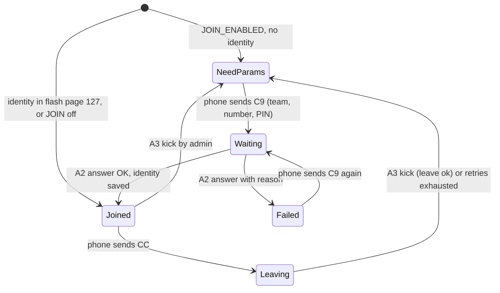
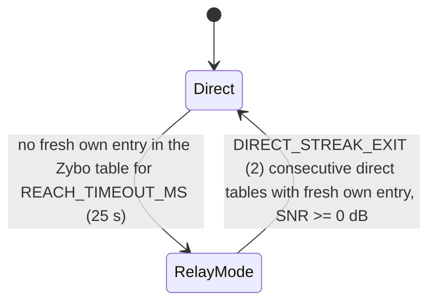

# STM32WL node / gateway firmware

One code base for the nodes and the gateway; the role is a compile-time setting. Based on ST's `SubGHz_Phy_PingPong`
example (STM32CubeWL). Current version **V1.17.3** (`SubGHz_Phy/App/app_version.h`).

| Item | Value |
|---|---|
| MCU | STM32WL55 (Cortex-M4 only) on NUCLEO-WL55JC; STM32WLE5 on Quectel KG200Z. Same binary. |
| Radio | LoRa, 869.525 MHz (`RF_FREQUENCY`), SF7, BW 125 kHz, CR 4/5, preamble 8 |
| TX power | `TX_OUTPUT_POWER = 17` dBm. KG200Z has only the HP PA connected: values <= 15 dBm give no TX. NUCLEO range -17...+22 dBm. |
| Regulation | EU 869.4-869.65 MHz sub-band, 10 % duty cycle |
| Position period | `TX_PERIOD_MS = 5000` + random `[0, TX_JITTER_MS = 1000)` |
| Toolchain | STM32CubeIDE, STM32CubeMX project `SubGHz_Phy_PingPong.ioc` |

Protocol, packet formats and flag bits: [`docs/protocol.md`](../../docs/protocol.md). Security envelope:
[`docs/security.md`](../../docs/security.md). Message flows: [`docs/architecture.md`](../../docs/architecture.md).

## Source layout

| Path | Content |
|---|---|
| `Core/Inc/app_mode.h` | Role and feature switches (single configuration point; not touched by CubeMX Generate Code) |
| `SubGHz_Phy/App/subghz_phy_app.h` | Packet structs, protocol constants |
| `SubGHz_Phy/App/subghz_phy_app.c` | Application (~3700 lines): TX scheduling, RX dispatch, table, commands/ACK, JOIN, relay, secure envelope, UART frame parser |
| `SubGHz_Phy/App/lora_secure.h` | AES-128 and AES-128-CCM, software, header-only |
| `SubGHz_Phy/App/net_key.example.h` | Template for the network key; copy to `net_key.h` (git-ignored) |
| `Core/Inc/sys_conf.h` | Log level, debugger, STOP2 low-power switch |
| `STM32CubeIDE/STM32WL55JCIX_FLASH.ld` | Last two flash pages reserved: page 126 security counter, page 127 JOIN identity |
| `tests/` | Host tests (gcc only), see [Host tests](#host-tests) |

## Configuration (`Core/Inc/app_mode.h`)

All switches are `#ifndef`-guarded, so they can be set either in the header or as `-D` options of the build
configuration.

| Switch | Default | Meaning |
|---|---|---|
| `GATEWAY_MODE` | 0 | 0 node, 1 gateway. Gateway only listens, forwards to the Zybo over USART1, STOP2 disabled. |
| `NODE_UART_BRIDGE` | 1 | Node only. 1: tables and status go to the ESP32 over USART1 (disables STOP2). 0: STOP2 low-power mode. |
| `JOIN_ENABLED` | 1 | Node only; needs `NODE_UART_BRIDGE 1` and `VIRTUAL_NODES 1`. 1: team identity via JOIN; without a stored identity the node sends **no position**. 0: address from the chip UID (bit15 = 0). |
| `SECURE_ENABLED` | 1 | 1: all air packets use the AES-128-CCM envelope. 0: plain packets. |
| `SECURE_ONLY` | 1 | With `SECURE_ENABLED 1`: 1 rejects plain packets, 0 accepts both (migration). |
| `VIRTUAL_NODES` | 1 | One board emulates up to 8 nodes (addresses `NODE_ADDR`, +1, ...). Each needs a Zybo whitelist entry. |
| `GATEWAY_LOCAL_TABLE` | 0 | Gateway without Zybo: keeps the table itself and broadcasts it every `DL_LOCAL_PERIOD_MS = 10000`. |
| `GW_FORWARD_CMD` | 1 | Gateway forwards each new `0xC1` command to the Zybo: `AA 55 11 <15 B> RSSI SNR CRC8` (21 B). |
| `GW_FORWARD_RELAY_INFO` | 1 | Gateway forwards relayed positions as `0xE1` frames (23 B) so the Zybo knows the relayer. 0: sent as a normal position frame. |
| `NODE_ADDR` | 0 | 0 = derive from UID. |
| `TEST_FAR_NODE` | 0 | Bench test: ignore everything from the gateway, so the node enters relay mode. Must be 0 in the field. |
| `TEST_GW_IGNORE_DIRECT` | 0 | Bench test: gateway drops direct positions and control from this address (e.g. `0x0F53`), accepts only relayed ones. Must be 0 in the field. |

### Settings per board

| Board | Role | `GATEWAY_MODE` | `NODE_UART_BRIDGE` | `JOIN_ENABLED` | Address | Peripherals |
|---|---|---|---|---|---|---|
| Gateway board | Gateway | 1 | - | - | - | Zybo PL over USART1 (PB6 TX, Pmod JC), 115200 8N1 |
| NUCLEO-WL55JC, box node | Node, team 2 | 0 | 1 | 1 | `0x8103` (ALPHA) | ESP32 + phone |
| KG200Z "BRAVO-1" | Node | 0 | 1 | 1 | `0x8201` | ESP32-S3 + iPhone |
| KG200Z "TE-B" | Node without phone | 0 | 0 (no ESP32; to be confirmed) | 0 | UID-derived (`0x0F3E`) | none |

`SECURE_ENABLED 1` and `SECURE_ONLY 1` on all boards. Join addresses are `0x8000 | team << 8 | number`
(`JOIN_ADDR`, team 1..26, number 1..99).

## Roles

### Node

- Sends a 12 B position every 5-6 s (random jitter), listens in between.
- Receives the Zybo's `0xD1` table (broadcast every 10 s), forwards it to the ESP32 if `NODE_UART_BRIDGE 1`.
- Receives admin commands (`C1`, `C3`); answers with an automatic `C5` ACK kind DELIVERED when a command is for it.
- Sends phone commands (`C1`, `C2`, `C5` kind SEEN, `A4` leave) received over the UART.
- Relays other nodes' packets when it can (see below).

### Gateway

- Holds **no key**. Forwards secure frames unopened: `0x51` frames of at least `SEC_PIPE_MIN_LEN = 25` B and `0x52`
  frames of at least `SEC_PIPE_MIN_LEN2 = 29` B, as `AA 55 LEN <packet> RSSI SNR CRC8`.
- Transmits frames from the Zybo (`AA 55 LEN <tx_repeat> <secure packet> CRC8`) `tx_repeat` times (max `SEC_TX_REPEAT_MAX = 5`);
  queue `SEC_TXQ_SIZE = 4`.
- Repeats every new `0xC1` command `CMD_RELAY_COUNT = 3` times over the air.

### UART framing (gateway and node bridge)

`AA 55 LEN payload CRC8`; CRC-8 poly `0x07`, init 0, over `LEN` + payload. Byte-wise parser in the UART IRQ
(`DLP_SYNC0 / SYNC1 / LEN / DATA / CRC`); a complete frame is copied to `dlFrame` and `EV_DL_FRAME` is posted.
Counters `dlCrcErrors`, `dlDropped`.

## Node states



`JOIN_ST_*` values 0..5 are reported to the phone in `0xCB` (`DISABLED, NEED_PARAMS, WAITING, JOINED, FAILED,
LEAVING`). `A1` is repeated every `JOIN_PERIOD_MS = 10000` + random `JOIN_PERIOD_RAND_MS = 5000`; `A4` is sent up to
`LEAVE_TRIES = 3` times, `LEAVE_RETRY_MS = 5000` apart. Result codes: `0` OK, `1` wrong PIN, `2` rejected, `3` team
full, `4` number taken, `5` kicked, `6` left.

Independent of JOIN, a node is either in **direct** or **relay mode**:



## Relay (single hop)

Wrappers: `E1` position relay, `E2` control relay (uplink), `E3` downlink relay (table, admin). `E1`/`E2` =
`[type][relayer addr 2][RSSI][SNR][far node's secure packet, unchanged]`; `E3` = `[E3][relayer addr 2][Zybo secure
packet]`. A node that reached the Zybo via a relayer does not relay for others.

### Entering relay mode

A node needs a relay when it has not seen a fresh own entry in the Zybo table for `REACH_TIMEOUT_MS = 25000`
(`Node_NeedsRelay`). The trigger is downlink-driven, not uplink: a shared downlink interruption puts all nodes in
relay mode at once. In relay mode, positions carry flag bit1 and use the `0x52` envelope (`relay_dev` field).
`C1`, `C2`, `C5`, `A4` use `0x52` as well while in relay mode.

An own table entry counts as fresh only if its `seq` is within `OWN_SEQ_FRESH = 4` of the last sent `seq`
(`Node_OwnSeqFresh`, V1.17.1); otherwise the Zybo's old record of a silent node would keep it out of relay mode.

### Gateway quality (flag bits 3..6)

`Node_GwQuality`: 0 unless the node saw itself fresh and direct in the table within 25 s (`Node_CanRelay`) **and**
heard the Zybo directly within 25 s. Otherwise `LINK_Q(snr) = clamp((SNR + 20) / 2, 1, 15)` of the last direct Zybo
frame. A node with quality 0 cannot be a relayer.

### Choosing a relayer (far node)

| Constant | Value | Meaning |
|---|---|---|
| `NB_MAX` | 8 | Tracked neighbours |
| `NB_TIMEOUT_MS` | 30000 | A neighbour not heard for this long is no candidate |
| `NB_HYST_STEPS` | 2 | A new candidate must be at least this much better than the current one |
| `NB_FAIL_MAX` | 2 | Consecutive positions without overhearing the chosen relayer's `E1` mark it bad |
| `NB_BAD_MS` | 60000 | Time a bad neighbour is excluded |

Score = min(link quality to the neighbour, neighbour's GW quality). Neighbours with GW quality 0 or marked bad are
skipped. No candidate: `relay_dev = 0xFFFFFFFF` (`SEC_RELAY_ANY`). A fresh own table entry with bit2 set confirms the
chosen relayer (`Relay_NoteTableOk`).

### Relayer behaviour (`Relay_RxMode`)

| `relay_dev` in the received `0x52` frame | Action |
|---|---|
| my dev_id | Relay after `RELAY_CHOSEN_DELAY_MIN_MS = 20` + random `RELAY_CHOSEN_DELAY_RAND_MS = 50` ms |
| `0xFFFFFFFF` | Relay after random `POS_RELAY_DELAY_MIN_MS = 100` + `POS_RELAY_DELAY_RAND_MS = 500` ms, cancelled if someone else relays first |
| another dev_id | Do not relay; drop that far node from the client list (`Client_Drop`) |

Client list: `MAX_RELAY_CLIENTS = 4`, `RELAY_CLIENT_TIMEOUT_MS = 30000`. Downlink relay (`E3`) is delayed by
`DL_RELAY_DELAY_MIN_MS = 50` + random `DL_RELAY_DELAY_RAND_MS = 250` ms.

### Leaving relay mode

Needs `DIRECT_STREAK_EXIT = 2` consecutive tables that are all of: heard directly (not via `E3`), contain a fresh
own entry, and are a direct copy (flag bit7 if the node has ever seen bit7, else bit2 = 0). Since V1.17.3 `E3` copies
do not reset the streak (only a directly heard table that fails a condition does), and the exit also needs
`SNR >= DIRECT_EXIT_SNR_MIN = 0` dB, so a weak downlink keeps the node in relay mode.

### Version compatibility

All nodes must run V1.17.2 or later before PL v11+ (which sets bit7) is live. Current PL is v12.

## ACK behaviour

`C5` kind 1 (DELIVERED) is sent automatically when an admin command for the node arrives; kind 2 (SEEN) comes from
the phone. Each ACK is sent `ACK_REPEAT = 3` times with a new `ack_seq`; the first delay is
`ACK_FIRST_DELAY_MIN_MS = 30` + random `ACK_FIRST_DELAY_RAND_MS = 170` ms, gaps
`ACK_REPEAT_GAP_MIN_MS = 500` + random `ACK_REPEAT_GAP_RAND_MS = 1500` ms. `Node_QueueAck` (queue `ACK_Q_SIZE = 3`)
removes duplicates.

## Persistent state

| Item | Location | Notes |
|---|---|---|
| Security counter | flash page 126 (`0x0803F000`) | Saved every `SEC_CTR_STEP = 256` packets, +256 on boot; 8 B slots `[ctr][~ctr]`, page erased when full |
| JOIN identity | flash page 127 (`0x0803F800`), magic `0x4E494F4A` | Survives re-flashing; a full chip erase deletes both pages |

## Build and flash

1. `Drivers/`, `Middlewares/`, `Utilities/` and `STM32CubeIDE/Application/User/` (startup, syscalls) are not in the
   repository. Open `SubGHz_Phy_PingPong.ioc` in STM32CubeMX and run **Generate Code**, or copy them from the same
   example in the STM32CubeWL package. User code sits in `USER CODE` blocks and `app_mode.h`, so Generate Code does
   not overwrite it.
2. Copy `SubGHz_Phy/App/net_key.example.h` to `net_key.h` and set the key. It must equal the key on the Zybo.
   `net_key.h` is git-ignored; never commit it.
3. Set the role in `app_mode.h` (see the board table).
4. STM32CubeIDE: import `STM32CubeIDE/`, **Clean**, Build.
5. Flash with ST-LINK (Run). With several ST-LINKs attached, select the serial number in the debug configuration.
6. Log: ST-LINK virtual COM port, 115200 baud.

On first boot with empty identity and counter pages, a JOIN node starts without identity and waits for the phone.

Log example:

```
APPLICATION_VERSION: V1.17.3
JOIN: kayitli kimlik takim=1 numara=1 adres=0x8101
SECURE: acik (sadece guvenli), dev_id=0xA3D2EEB3, sayac=513
MODE=NODE
[TX] addr=0x8101 seq= 12 lat=40.9856843 lon=28.8317307
[TABLO] 2 node (rssi=-24 snr=13):
```

Log strings are Turkish.

## Host tests

```bash
cd tests && ./run_tests.sh
```

Needs only `gcc`. The application file is compiled with stub HAL, radio and timers. Thirteen groups: crypto,
mesh (relayer, far node, gateway), JOIN (node, gateway), secure (node, node-only, gateway, join, gateway-only) and
relay selection (relayer, far node). Last run: all pass. `tests/stubs/net_key.h` is a dummy key (`00 01 ... 0F`) and
is the only `net_key.h` tracked in git.

## Pre-field checklist

- `TX_OUTPUT_POWER = 17` on all boards (KG200Z: > 15 dBm).
- `TEST_FAR_NODE = 0`, `TEST_GW_IGNORE_DIRECT = 0`.
- Real network key on all nodes and on the Zybo; `SECURE_ONLY 1`.
- RDP Level 1 on the nodes (option byte `BB`) as the last step; never Level 2 (`CC`, irreversible). Regressing from
  RDP 1 to 0 (`AA`) erases flash, including identity and counter.
- Same firmware version on every board.

## Known limitations

- UART frame parser has no inter-byte timeout; a frame cut mid-way is resynchronised only by the next sync bytes.
- Relay is single-hop.
- One shared network key; see [`docs/security.md`](../../docs/security.md).
- Comments and log strings are Turkish.
- Flashing two boards with `GATEWAY_MODE 1` is a common setup mistake; the roles are not checked at run time.
