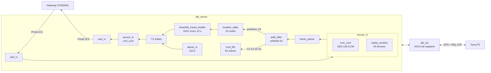

# Zybo PL: A.T.A.K. server

The PL implements the server side of the radio protocol: it receives gateway frames over UART, authenticates and
decrypts them, filters by whitelist, keeps the location table, broadcasts the 0xD1 table, queues commands for
Linux and sends admin frames. Linux sees it as one AXI4-Lite slave (`atk_axi`) at `0x4000_0000`.

Target: Zybo Z7-20 (`xc7z020clg400-1`), Vivado 2025.2, PL clock 100 MHz (`FCLK_CLK0`), UART 115200 8N1.
Current version: **v12**, ID register `0x41544B0C`.

Packet formats and flag bits: [`docs/protocol.md`](../../docs/protocol.md). Software side: [`fpga/ps/README.md`](../ps/README.md).

## Block diagram



Uplink: `uart_rx` → `secure_rx` → `frame_parser` → `addr_filter` → `location_table` / `cmd_fifo`.
Downlink: `downlink_frame_builder` / `admin_tx` → arbiter → `secure_tx` → `uart_tx`.
The arbiter sends one frame at a time with at least 100 ms of idle line between frames (gateway requirement);
the table frame has priority.

## Modules

| Module | Function |
|---|---|
| `atk_axi` | Top of the IP: AXI4-Lite register file, interrupt, security registers around `atk_server` |
| `atk_server` | Server datapath (uplink, table, command FIFO, downlink, TX arbiter) |
| `atk_rx_top` | Uplink chain `uart_rx` → `secure_rx` → `frame_parser` → `addr_filter` |
| `uart_rx`, `uart_tx` | 8N1 UART, 115200 baud |
| `secure_rx` | Buffers a frame, checks the CCM MIC and the replay window, decrypts, unwraps nested E1/E2, drops E3, merges direct / relayed copies (v11), passes plain frames only while `SECURE_ONLY = 0` |
| `secure_tx` | Wraps downlink frames in the 0x51 envelope when `SECURE_TX = 1`; downlink counter +1 per frame |
| `ccm_core` | AES-128-CCM encrypt / decrypt in place, 256-byte buffer, 4-byte MIC |
| `aes128_enc` | AES-128 block encryption, 11 clocks per block |
| `replay_window` | Per-device last counter + 32-bit bitmap for 64 devices; tracks which path (direct / relayed) delivered the newest counter |
| `frame_parser` | `AA 55 LEN … CRC8` framing, length and CRC checks, field extraction |
| `addr_filter` | 64-entry whitelist, initialised from `whitelist.mem`, writable from Linux |
| `location_table` | Last record of up to 16 nodes with RSSI/SNR, age, relay path and chosen relayer; merges copies (flags bits 2 / 7) |
| `cmd_fifo` | 64-entry FIFO of commands (0xC1 / 0xC2 / 0xC5) and join requests (0xA1) with RSSI/SNR and arrival time |
| `downlink_frame_builder` | 0xD1 table of fresh nodes every 10 s or on request |
| `admin_tx` | 0xC3 admin frame from a 15-byte payload written by Linux |
| `zybo_atk_top`, `debounce` | Standalone board top without PS (125 MHz oscillator, buttons, LEDs); bring-up only, no security |

## Register map

32-bit registers, byte offsets from `0x4000_0000`, little-endian. The authoritative description is the header of
[`rtl/atk_axi.v`](rtl/atk_axi.v).

### Control and status

| Offset | Name | Access | Description |
|---|---|---|---|
| `0x000` | `ID` | R | `0x41544B0C` ("ATK", version 12) |
| `0x004` | `CONTROL` | W | bit 0: send the table now; bit 1: soft reset (table, counters, command FIFO). Pulses |
| `0x008` | `TABLE_COUNT` | R | Nodes in the location table (0–16) |
| `0x00C` | `FRAMES_OK` | R | Accepted uplink frames |
| `0x010` | `DROPPED_ADDR` | R | Valid frames from addresses not in the whitelist |
| `0x014` | `CRC_ERRORS` | R | |
| `0x018` | `FRAMING_ERRORS` | R | UART bytes with a bad stop bit |
| `0x01C` | `LENGTH_ERRORS` | R | |
| `0x020` | `TIMEOUT_ERRORS` | R | Frames cut off (1 ms without a byte) |
| `0x024` | `FULL_DROPS` | R | New nodes ignored because the table was full |
| `0x028` | `FRAMES_SENT` | R | Downlink table frames sent |
| `0x030` | `IRQ_STATUS` | R/W1C | bit 0: position accepted; bit 1: command stored |
| `0x034` | `IRQ_ENABLE` | R/W | bits 1..0 enable the interrupt for the matching status bit |
| `0x038` | `NOW_S` | R | Seconds since reset |
| `0x03C` | `STALE_S` | R/W | Nodes not heard for this many seconds leave the downlink (default 60, 0 = never) |
| `0x040` | `WL_INDEX` | R/W | Whitelist entry (0–63) for `WL_DATA` |
| `0x044` | `WL_DATA` | R/W | bit 16: in use; bits 15..0: node address. Write stores |
| `0x048` | `FRESH_MASK` | R | bit i: table entry i is in the downlink |
| `0x084` | `TBL_DELETE` | W / R | W: remove node (bits 15..0) from the table. R: deletions so far |

### Command FIFO and admin TX

| Offset | Name | Access | Description |
|---|---|---|---|
| `0x04C` | `CMD_WR_COUNT` | R | Commands stored (monotonic); command n is entry n mod 64 |
| `0x050` | `CMD_RD_COUNT` | R/W | Commands consumed by Linux; full when WR − RD = 64 |
| `0x054` | `CMD_OVERFLOWS` | R | Commands dropped, FIFO full (the new one is dropped) |
| `0x058` | `CMDS_OK` | R | Commands accepted (source whitelisted) |
| `0x05C` | `CMDS_DROPPED` | R | Commands from sources not whitelisted |
| `0x060`–`0x06C` | `ADMIN_DATA0..3` | R/W | 15-byte 0xC3 payload, byte 0 in bits 7..0 of `ADMIN_DATA0` |
| `0x070` | `ADMIN_CTRL` | W / R | W bit 0: send. R bit 0: busy |
| `0x074` | `ADMIN_SENT` | R | Admin frames sent |
| `0x078` | `RELAYS_OK` | R | Accepted relayed positions (0xE1) |
| `0x07C` | `JOINS_OK` | R | Join requests (0xA1) passed to the FIFO |
| `0x080` | `JOINS_LIMITED` | R | Join requests dropped by the 1 per second limit |

### Security

`SEC_CTRL`, the key and `DL_CTR` are not affected by the soft reset.

| Offset | Name | Access | Description |
|---|---|---|---|
| `0x088` | `SEC_CTRL` | R/W | bit 0 `SECURE_TX`; bit 1 `SECURE_ONLY`; bit 2 (W pulse) clear the replay table. Reset value `0x2` |
| `0x08C`–`0x098` | `KEY0..3` | W | 128-bit key, key byte 4i in bits 7..0 of `KEYi`. Reads return 0 |
| `0x09C` | `DL_CTR` | R/W | Next downlink counter. Must never repeat under one key |
| `0x0A0` | `SEC_OK` | R | Secure uplink frames accepted |
| `0x0A4` | `PLAIN_OK` | R | Plain uplink frames passed (`SECURE_ONLY = 0`) |
| `0x0A8` | `PLAIN_DROP` | R | Plain uplink frames dropped (`SECURE_ONLY = 1`) |
| `0x0AC` | `MIC_FAIL` | R | Wrong MIC (forged frame or wrong key) |
| `0x0B0` | `REPLAY_DROP` | R | Counter already used or outside the window |
| `0x0B4` | `RELAY_DUP` | R | Relayed copy of a frame already received |
| `0x0B8` | `E3_DROP` | R | Own downlink relayed back |
| `0x0BC` | `SEC_SENT` | R | Secure downlink frames |
| `0x0C0` | `PLAIN_SENT` | R | Plain downlink frames |
| `0x0C4` | `SRX_OVERRUNS` | R | Uplink frames lost while the previous one was being checked (expected 0) |
| `0x0C8` | `RELAY_UPG` | R | Second copies on the other path merged into the table entry (v11) |

### Tables

| Offset | Content |
|---|---|
| `0x100 + 16·i` | Table entry i (0–15). Words 0–2: the 12-byte position record as received (`addr u16, seq u8, lat i32, lon i32, flags u8`). Word 3: `{age s [31:16], SNR i8 [15:8], RSSI i8 [7:0]}`. Reading word 0 latches the entry; read word 0 first |
| `0x200 + 4·i` | VIA of entry i: `{relay SNR i8, relay RSSI i8, relayer u16}`; 0 = heard directly |
| `0x240 + 4·i` | RDEV of entry i: dev_id of the relayer the node chose (0x52); 0 = none, `FFFFFFFF` = any |
| `0x800 + 32·k` | Command FIFO entry k (0–63): +0..+12 raw command bytes, +16 `{SNR, RSSI}`, +20 arrival `NOW_S`, +24 sequence number; 0xA1 byte 16 at +28 |

### Flags byte (position record)

| Bit | Set by | Meaning |
|---|---|---|
| 1 | Node | Node requests a relay |
| 2 | PL | A relayed copy of this seq arrived |
| 3–6 | Node | Node's own gateway link quality (0–15) |
| 7 | PL | A direct copy of this seq arrived (v11) |

Bits 2 and 7 are written by the PL into the stored record and are therefore also in the 0xD1 downlink.

## Resources and timing

Post-implementation, complete design (PS, HDMI pipeline, `atk_axi`), Vivado 2025.2, `xc7z020clg400-1`:

| Resource | Used | Available | % |
|---|---|---|---|
| Slice LUTs | 15 082 | 53 200 | 28.4 |
| Slice registers | 13 589 | 106 400 | 12.8 |
| Block RAM tiles | 17 | 140 | 12.1 |
| DSP | 0 | 220 | 0 |

| Timing (all clocks) | Value |
|---|---|
| WNS (setup) | +0.575 ns |
| WHS (hold) | +0.011 ns |
| Failing endpoints | 0 of 29 901 |

The worst setup path is the AXI table read: `atk_axi` entry index → `location_table` read port (`rd2_via`). `build.tcl` writes the full reports to
`build/utilization.txt` and `build/timing_summary.txt`.

## Building

```sh
cd fpga/pl
vivado -mode batch -source scripts/create_project.tcl     # -> build/atak_pl.xpr
vivado -mode batch -source scripts/build.tcl              # -> build/system_wrapper.xsa, reports in build/
```

Requires the Digilent board files for the Zybo Z7-20. `build.tcl` fails if timing is not met. The XSA is the input
of [`fpga/ps/petalinux/build_boot.sh`](../ps/petalinux/build_boot.sh). `scripts/system_bd.tcl` is the block design
exported with `write_bd_tcl`; after changing the block design in the GUI, export it again:

```tcl
write_bd_tcl -force -no_ip_version <repo>/fpga/pl/scripts/system_bd.tcl
```

`ip/rgb2dvi` and `ip/if/tmds_v1_0` are from Digilent's [vivado-library](https://github.com/Digilent/vivado-library)
(MIT license) and are used unmodified for the HDMI output.

## Simulation

Self-checking testbenches for every module and for the integrated server, run with the Vivado simulator (xsim):

```bat
fpga\pl\sim\run_all.bat           :: all testbenches, logs in sim\logs\, exit code = failures
fpga\pl\sim\run_atk_axi.bat       :: one testbench
```

`XILINX_VIVADO` selects the Vivado installation (default `C:\AMDDesignTools\2025.2\Vivado`).

| Testbench | Covers |
|---|---|
| `tb_uart_rx`, `tb_uart_tx`, `tb_debounce` | Basic blocks |
| `tb_aes128_enc` | FIPS-197 vectors |
| `tb_ccm_core` | CCM encrypt / decrypt, tampered frames, firmware reference vector |
| `tb_secure_rx` | 49 frames: MIC, replay, E1/E2/E3 nesting, copy merge, counters |
| `tb_secure_tx` | Envelope, counter, golden frames from the node firmware |
| `tb_frame_parser`, `tb_addr_filter`, `tb_location_table`, `tb_downlink_frame_builder` | Datapath blocks |
| `tb_atk_rx_top`, `tb_atk_server`, `tb_atak_multinode` | Integrated uplink / server, several nodes |
| `tb_atk_axi` | Full IP through the register interface, including the firmware golden frames end to end |

Reference vectors (`tb/*_vectors.svh`) are generated by `tb/gen/` from the firmware's test key and golden frames;
they contain no production key. Regenerate after changing a generator (needs `pip install cryptography`):

```sh
cd fpga/pl/tb/gen
python gen_ccm.py ../ccm_vectors.svh
python gen_srx.py ../srx_vectors.svh
python gen_stx.py ../stx_vectors.svh
```

## Version history

The ID register identifies the loaded bitstream; scripts and GUI accept v4–v12 and disable missing features.

| Version | ID | Change |
|---|---|---|
| v4 | `0x41544B04` | AXI4-Lite interface, run-time whitelist, command FIFO (0xC1 / 0xC2), admin TX (0xC3) |
| v5 | `0x41544B05` | 0xC5 ACKs in the command FIFO |
| v6 | `0x41544B06` | Relayed positions (0xE1), VIA words |
| v7 | `0x41544B07` | Join requests (0xA1), rate limit |
| v8 | `0x41544B08` | `TBL_DELETE`, 0xA4 leave |
| v9 | `0x41544B09` | AES-128-CCM envelope (0x51), replay window, `SEC_CTRL`, key and counter registers |
| v10 | `0x41544B0A` | Relay choice (0x52 with relay_dev), RDEV words, flags bit 2 set by the PL |
| v11 | `0x41544B0B` | Direct / relayed copies merged per seq: flags bit 7, `RELAY_UPG` |
| v12 | `0x41544B0C` | `SECURE_ONLY = 1` out of reset: nothing is accepted before the key is loaded |
