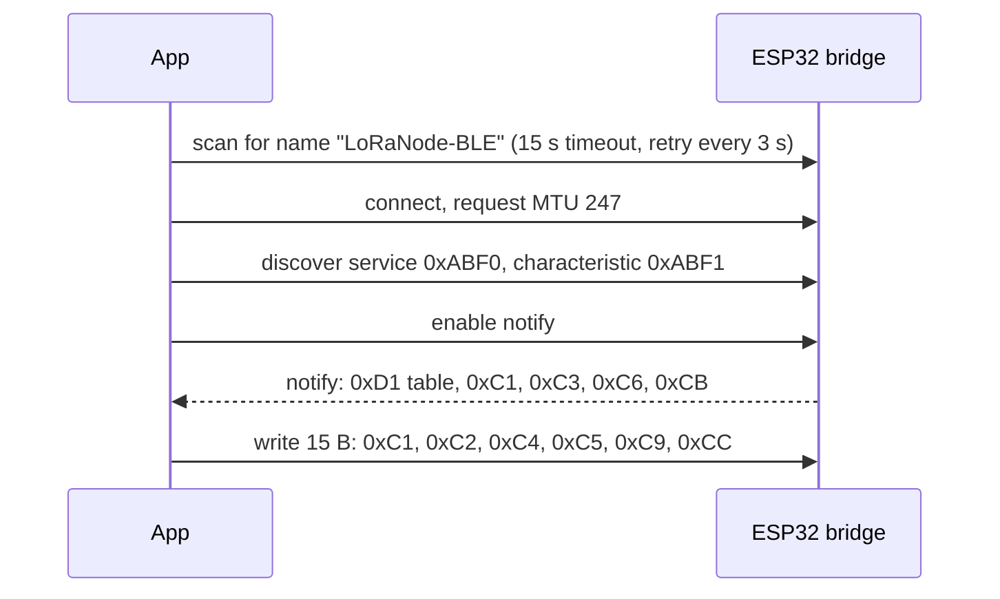

# Mobile app (`lora_tracker`)

Flutter app for Android and iOS. It connects to a node through the ESP32 BLE bridge, shows the team on an offline map
and sends markers and commands. No internet is needed at run time. Dart SDK `^3.13.5`; main packages:
`flutter_blue_plus`, `flutter_map`, `flutter_map_mbtiles`, `geolocator`.

Bridge side of the BLE link: [`esp32-bridge/README.md`](../esp32-bridge/README.md). Packet formats:
[`docs/protocol.md`](../docs/protocol.md).

## Features

- Nodes on the offline map with team colour and name (e.g. ALPHA-2); nodes without a team are red with the hex address.
- **Team / Identity** screen: join with team, number (0 = admin chooses) and PIN; status (waiting for approval,
  rejection reason, suggested number), leave team, warning when the admin kicks the node.
- **Position sharing:** the phone's GPS is the node's position (`0xC4`). A manual test position can be set by long
  press on the map.
- **Admin ✓** chip: whether the node's last position is in the admin's table (direct / via relay / absent).
- Radial menu for markers and commands: point of interest, danger, rally, come here, wait here, check area.
  ✓ = sent, ✓✓ = reached the network (echo of the admin's broadcast).
- Alert dialog for admin commands; OK / Find sends a SEEN ACK.
- Delete request for a marker; removal on admin decision.
- **Find** screen: bearing and distance to a target.

## BLE flow

| Constant | Value | File |
|---|---|---|
| `kDeviceName` | `LoRaNode-BLE` | `lib/main.dart` |
| `kServiceUuid` / `kCharUuid` | `abf0` / `abf1` | `lib/main.dart` |
| `kPosMinGap` | 5 s: shortest interval of `0xC4` position writes | `lib/main.dart` |
| `kPosRefresh` | 15 s: position is re-sent even without movement | `lib/main.dart` |

The app writes only 15-byte packets; the bridge rejects any other length or type. Notifications carry the payload
without `AA 55`, length and CRC. The notification is cut at ATT MTU - 3, so the MTU request matters for tables with
many nodes (iPhone typically negotiates 185 B).

If two bridges are in range, give one a different BLE name and set `kDeviceName` to the same value in that phone's
app build.

## Source files

| File | Content |
|---|---|
| `lib/main.dart` | BLE scan / connect, dispatch of incoming packets, status bar |
| `lib/cmd_packet.dart` | Control, position, ACK, node status and JOIN packets |
| `lib/table_parser.dart` | `0xD1` table decoder |
| `lib/teams.dart` | Team names and colours, address to name (ALPHA-2) |
| `lib/join_page.dart` | Team / Identity screen |
| `lib/map_view.dart` | flutter_map + MBTiles map, node and marker layers |
| `lib/marks.dart`, `lib/radial_menu.dart` | Marker model and selection menu |
| `lib/find_page.dart` | Find screen |
| `lib/location_service.dart` | Phone GPS, manual test position |
| `android/`, `ios/` | Platform projects (permissions: Bluetooth and location, in `AndroidManifest.xml` and `Info.plist`) |

## Build

### Android

1. Put the offline map at `assets/map.mbtiles`. It is not in the repository (about 15 MB; `assets/*.mbtiles` is
   git-ignored).
2. The Android project is incomplete in git (only `AndroidManifest.xml`). Run once in this folder:
   `flutter create --platforms=android .` (does not overwrite existing files).
3. `flutter pub get`, then `flutter run`.

### iPhone (without a Mac)

The previous repository built an unsigned IPA with a manually started GitHub Actions workflow on `macos-15`
(`flutter build ios --release --no-codesign`, zip `Runner.app` into `Payload/`, upload as artifact). The workflow is
not part of this repository yet. Because the map is git-ignored, the CI build needs the MBTiles file available to the
runner.

Install on a device:

1. Download the unsigned `.ipa` from the workflow artifact.
2. On Windows use Sideloadly (iTunes and iCloud from apple.com installed) with your own Apple ID.
3. On the iPhone: Settings, General, VPN & Device Management, trust the profile. On iOS 16+ enable Developer Mode
   (Privacy & Security).

A free Apple ID signature expires after 7 days; installing the same `.ipa` again renews it. Private repositories have
limited free macOS minutes (about 190 per month on the free plan; one build takes 10-15 minutes).

On iOS the app stops BLE in the background; keep it in the foreground.

## Known limitations

- BLE link is unauthenticated and unencrypted ([`docs/security.md`](../docs/security.md#known-gaps)).
- No explicit alert when the BLE link drops (open item); the app retries the connection every 3 s.
- Tables larger than the negotiated MTU are truncated by the bridge.
- Comments and UI strings are Turkish.
